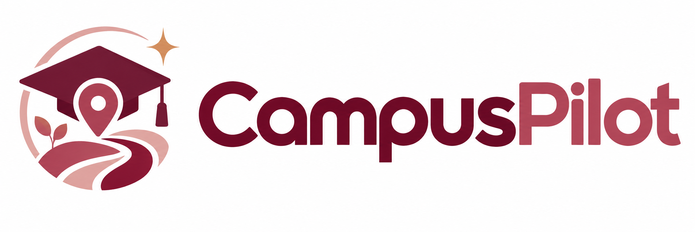
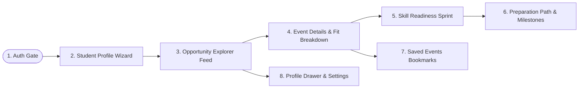
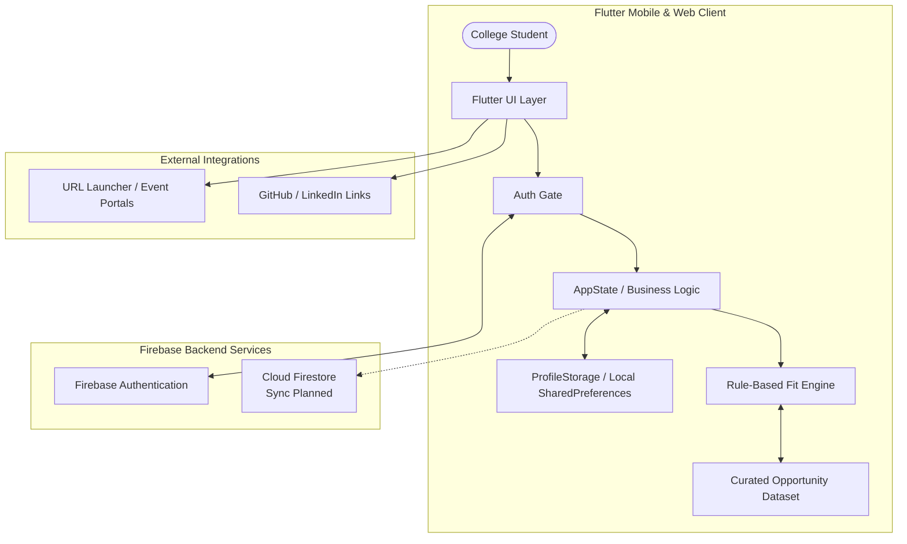

<p align="center">
  
</p>

# 🎓 CampusPilot

### Discover Opportunities That Match Your Skills. Bridge Gaps. Build Your Path.

**CampusPilot** is an open-source, personalized student opportunity discovery and skill readiness platform built with Flutter and Firebase. It helps college students navigate through hackathons, workshops, open-source initiatives, competitions, and student events tailored to their technical background, college year, and career aspirations.

---

<p align="center">
  <a href="https://flutter.dev"></a>
  <a href="https://dart.dev"></a>
  <a href="https://firebase.google.com"></a>
  <a href="https://firebase.google.com"></a>
  <a href="https://github.com/Mohanapriya-sparks/CampusPilot/actions"></a>
  <a href="LICENSE"></a>
  
  
</p>

<p align="center">
  <b><a href="#-quick-links">Quick Links</a></b> ·
  <b><a href="#-problem-statement">Problem Statement</a></b> ·
  <b><a href="#-mvp-user-flow">MVP Flow</a></b> ·
  <b><a href="#-key-features">Key Features</a></b> ·
  <b><a href="#-system-architecture">Architecture</a></b> ·
  <b><a href="#-tech-stack">Tech Stack</a></b> ·
  <b><a href="#-getting-started--running-locally">Run Locally</a></b> ·
  <b><a href="#-honest-mvp-scope--originality">Originality & Scope</a></b>
</p>

---

> [!NOTE]
> **Originality & Intellectual Honesty Statement:**
> CampusPilot is an original student opportunity discovery project. It is not a pixel-for-pixel copy of platforms such as Unstop, Knowafest, or any reference repository. Visual presentation, UX flow, and matching logic are original implementations tailored for student empowerment.
> 
> *This release is an MVP (Minimum Viable Product).* Recommendations currently leverage transparent rule-based skill alignment, and events are curated sample datasets rather than unvetted live scrapers.

---

## ⚡ Quick Links

- 📖 **[System Architecture](docs/architecture.md)** — In-depth architectural layers and data pipeline.
- 🗺️ **[User Journey & Flow](docs/mvp-flow.md)** — Step-by-step user onboarding and screen flows.
- 📸 **[Screenshots & Design Specs](docs/screenshots.md)** — Screen captures and UI layout specifications.
- 🔒 **[Security Policy](SECURITY.md)** — Safe credential handling and reporting procedures.
- 🤝 **[Contributing Guidelines](CONTRIBUTING.md)** — How to submit pull requests and propose features.

---

## 📌 Problem Statement

College students face a fractured, noisy environment when trying to build technical credentials and gain practical experience outside the classroom:

1. **Information Fragmentation**: Hackathons, webinars, open-source cohorts, and college symposiums are scattered across WhatsApp forward chains, Telegram groups, obscure college portals, and LinkedIn posts.
2. **The "Cold Start" Imposter Syndrome**: Students often look at high-profile hackathons or open-source programs and assume they are not ready, without understanding which specific skills are actually missing.
3. **No Preparation Bridge**: Traditional portals function only as event directories — they list deadlines but offer no learning roadmap, diagnostic checks, or personalized preparation steps to help students qualify and compete.
4. **Context Blindness**: General event listings do not account for a student's degree, current year, or technical stack, leading to feed fatigue.

---

## 💡 Solution

**CampusPilot** rethinks event discovery as a **guided journey**:

- **Personalized Discovery**: Instead of generic directories, students receive a curated feed with a clear **Fit Percentage** computed against their skill inventory.
- **Transparent Recommendation Reasoning**: Students see *why* an event was suggested (e.g., *"Matched on Flutter & Firebase; missing Docker"*).
- **Skill Readiness Sprints**: Interactive diagnostic challenges test readiness and pinpoint concrete skill gaps before registration.
- **Actionable Preparation Paths**: A guided roadmap breaks down prerequisites into manageable milestones with vetted learning resources and checklist tracking.

---

## 🎯 Why CampusPilot?

| Traditional Event Portals | CampusPilot MVP |
| ------------------------- | --------------- |
| Static event listings with search filters | Personalized feed ranked by student skill alignment |
| Opaque recommendations | Transparent, explainable rule-based fit scores |
| Ends at the external registration link | Continues with Skill Readiness Sprints & Preparation Paths |
| Overwhelming list of requirements | Step-by-step milestone checklist with curated learning resources |
| Generic profiles | Comprehensive academic + skill + portfolio identity |

---

## 🔄 MVP User Flow



1. **Authentication**: Sign in via Email/Password or Google OAuth with session persistence.
2. **Student Profile**: Onboarding captures college, degree, department, year, skills, interests, and GitHub/LinkedIn links.
3. **Opportunity Explorer**: Discover hackathons, workshops, open-source programs, and competitions with real-time category filtering.
4. **Opportunity Details**: Review event schedule, mode (Online/Offline/Hybrid), organizer, and recommendation rationale.
5. **Skill Readiness**: Take a rapid sprint challenge to diagnose skill gaps.
6. **Preparation Path**: Follow structured preparation milestones with learning resources and progress checkboxes.
7. **Saved Events**: Bookmark opportunities for quick access.
8. **Profile Drawer**: Manage profile data, access shortcuts, and securely log out.

---

## ✨ Key Features

### 1. 🔐 Firebase Authentication & Session Gate
- Reliable email and password authentication with client-side form validation.
- Google Sign-In scaffolding for low-friction onboarding.
- `AuthGate` session manager automatically restores authenticated sessions on restart and clears cache upon sign-out.

### 2. 👤 Comprehensive Student Profile
- Progressive 7-section profile form:
  - **Academic Details**: College name, Degree (B.Tech, B.Sc, BCA, etc.), Department, Graduation year.
  - **Skill Inventory**: Tag selection across modern tech stacks (Flutter, Python, Machine Learning, Web3, etc.).
  - **Interests & Formats**: Preferred engagement modes and interest domains.
  - **Portfolio Handles**: Connected GitHub and LinkedIn profile links.
- Scoped persistence using `SharedPreferences` isolated by Firebase UID.

### 3. 🧭 Opportunity Explorer & Dynamic Filtering
- Multi-category discovery catalog:
  - 🏆 **Hackathons** (e.g. Smart India Hackathon, TreeHacks, Global AI Hackathon)
  - 🛠️ **Workshops** (e.g. Flutter Cloud Sprint, Kubernetes Deep Dive)
  - 🌐 **Open Source Programs** (e.g. Google Summer of Code, GirlScript Summer of Code)
  - 🏅 **Competitions & Contests** (e.g. ICPC Regional Qualifier, Campus Innovation Cup)
- Real-time search across titles, organizers, and technology tags.
- Instant category switching with active badge count indicators.

### 4. 📊 Opportunity Details & Recommendation Engine
- Full metadata view: event dates, venue location, mode (Online/Offline/Hybrid), and entry fee.
- **Fit Percentage Gauge**: Dynamic calculation highlighting skill overlap.
- **Recommendation Rationale**: Human-readable breakdown of matched vs. missing prerequisites.
- Direct external registration linking via `url_launcher`.

### 5. ⚡ Skill Readiness Sprints
- Short interactive diagnostic sprint to assess prerequisite mastery.
- Instant readiness scoring gauge (0–100%) and personalized feedback.
- Clear identification of key skill gaps needed for the target opportunity.

### 6. 🛣️ Personalized Preparation Paths & Open Source Flow
- Tailored milestone roadmap (e.g. Setup Environment ➔ Build Prototype ➔ Pitch Presentation).
- High-yield learning resource cards linking to documentation and starter guides.
- Interactive checklist saving completed milestones.
- Dedicated Open Source contributor flow for first-time open-source applicants.

### 7. 🔖 Saved Events & Bookmarks
- Instant one-tap bookmarking to curate a personal opportunity watchlist.
- Persistent local storage so saved events survive application restarts.

### 8. 🗂️ Ergonomic Profile Drawer
- Custom student banner with avatar initials and academic summary.
- One-tap links to student's external GitHub and LinkedIn profiles.
- Seamless navigation shortcuts to My Profile, Saved Events, Open Source Path, and Sign Out.

---

## 🏛️ System Architecture



### Layered Architecture Flow:
1. **User Interaction** ➔ Triggers actions in the Flutter UI.
2. **Flutter UI** ➔ Communicates with `AppState` and responds to observable state changes.
3. **Firebase Authentication** ➔ Manages identity, token lifecycles, and user sessions.
4. **Student Profile / App State** ➔ Holds student profile in-memory and handles state mutations.
5. **Opportunity Explorer** ➔ Filters and presents opportunities with rule-based fit scores.
6. **Opportunity Details** ➔ Displays deep metadata, recommendation reasoning, and save actions.
7. **Skill Readiness** ➔ Conducts diagnostic quizzes and calculates readiness percentages.
8. **Preparation Path** ➔ Guides milestone progress with curated learning cards.
9. **Firestore / Local Storage** ➔ Persists user profiles and saved event IDs cleanly by UID.

---

## 🛠️ Tech Stack

| Component | Technology | Version | Purpose |
| --------- | ---------- | ------- | ------- |
| **Framework** | Flutter | `^3.24.5` | Cross-platform UI toolkit (Web, Android, iOS, Desktop) |
| **Language** | Dart | `^3.5.4` | Null-safe, modern language |
| **Authentication** | Firebase Auth | `^6.4.0` | User account lifecycle (Email/Password & Google) |
| **Cloud Database** | Cloud Firestore | `^6.3.0` | Cloud synchronization of profiles and saved events |
| **Core Services** | Firebase Core | `^4.7.0` | Firebase app initialization & platform bindings |
| **Local Persistence** | Shared Preferences | `^2.3.2` | Local UID-scoped key-value caching for offline use |
| **URL Launcher** | url_launcher | `^6.3.1` | Opening registration links, GitHub, and LinkedIn |
| **File Picker** | file_picker | `^8.1.7` | Resume file selection scaffold |
| **Linting & Analysis** | flutter_lints | `^5.0.0` | Official Dart code style and static analysis rules |

---

## 📂 Project Structure

```
CampusPilot/
├── .github/
│   ├── ISSUE_TEMPLATE/
│   │   ├── bug_report.md
│   │   └── feature_request.md
│   ├── workflows/
│   │   └── flutter_ci.yml
│   └── pull_request_template.md
├── assets/
│   └── images/
│       ├── branding/
│       ├── events/
│       ├── social/
│       └── campuspilot_logo.png
├── docs/
│   ├── screenshots/
│   │   └── README.md
│   ├── architecture.md
│   ├── mvp-flow.md
│   └── screenshots.md
├── lib/
│   ├── models/
│   │   ├── opportunity.dart
│   │   ├── preparation_step.dart
│   │   └── student_profile.dart
│   ├── screens/
│   │   ├── bridge_mission_screen.dart
│   │   ├── event_details_screen.dart
│   │   ├── event_learning_path_screen.dart
│   │   ├── events_screen.dart
│   │   ├── login_screen.dart
│   │   ├── main_shell.dart
│   │   ├── opportunity_explorer_screen.dart
│   │   ├── profile_setup_screen.dart
│   │   ├── signup_screen.dart
│   │   ├── skill_sprint_challenge_screen.dart
│   │   ├── skill_sprint_result_screen.dart
│   │   └── splash_screen.dart
│   ├── state/
│   │   └── app_state.dart
│   ├── storage/
│   │   └── profile_storage.dart
│   ├── theme/
│   │   ├── app_colors.dart
│   │   └── app_theme.dart
│   ├── utils/
│   │   └── url_helper.dart
│   ├── widgets/
│   │   ├── campus_card.dart
│   │   ├── event_card.dart
│   │   ├── fit_badge.dart
│   │   ├── metric_ring.dart
│   │   ├── opportunity_card.dart
│   │   ├── profile_drawer.dart
│   │   └── tag_chip.dart
│   ├── app.dart
│   ├── auth_gate.dart
│   ├── firebase_options.dart
│   └── main.dart
├── test/
│   └── widget_test.dart
├── .env.example
├── .gitignore
├── CHANGELOG.md
├── CONTRIBUTING.md
├── LICENSE
├── README.md
├── SECURITY.md
├── analysis_options.yaml
├── firebase.json
└── pubspec.yaml
```

---

## 🔥 Firebase Setup

To connect CampusPilot to your own Firebase project:

1. **Install the Firebase CLI and FlutterFire CLI**:
   ```bash
   npm install -g firebase-tools
   dart pub global activate flutterfire_cli
   ```
2. **Log into Firebase**:
   ```bash
   firebase login
   ```
3. **Configure your Flutter project**:
   ```bash
   flutterfire configure --project=your-firebase-project-id
   ```
   This generates or updates `lib/firebase_options.dart` with your client configurations.

4. **Enable Firebase Authentication**:
   - Go to the **Firebase Console** ➔ **Authentication** ➔ **Sign-in method**.
   - Enable **Email/Password**.
   - (Optional) Enable **Google Sign-In** and add your web/Android SHA-1 fingerprints.

5. **Configure Firestore Rules** (for Cloud Sync):
   ```javascript
   rules_version = '2';
   service cloud.firestore {
     match /databases/{database}/documents {
       match /users/{userId}/{document=**} {
         allow read, write: if request.auth != null && request.auth.uid == userId;
       }
       match /opportunities/{opportunityId} {
         allow read: if true;
         allow write: if false; // Admin managed
       }
     }
   }
   ```

---

## 🚀 Getting Started & Running Locally

### Prerequisites
- **Flutter SDK**: `>=3.3.0 <4.0.0` (Tested on Flutter `3.24.5` / Dart `3.5.4`)
- **Google Chrome** (for web execution)
- **Git**

### Installation Steps

1. **Clone the repository**:
   ```bash
   git clone https://github.com/Mohanapriya-sparks/CampusPilot.git
   cd CampusPilot
   ```

2. **Install Flutter packages**:
   ```bash
   flutter pub get
   ```

3. **Verify code quality & analyzer**:
   ```bash
   dart format lib
   flutter analyze
   flutter test
   ```

4. **Launch the application**:

   **Run on Chrome (Web)**:
   ```bash
   flutter run -d chrome
   ```

   **Run on Android Emulator / Physical Device**:
   ```bash
   flutter run
   ```

   **Run on Windows Desktop**:
   ```bash
   flutter run -d windows
   ```

---

## 📸 Screenshots & UI Preview

Visual screen previews for key MVP user touchpoints. See [docs/screenshots.md](docs/screenshots.md) for full image specifications.

| 01. Login & Authentication | 02. Opportunity Explorer |
| :---: | :---: |
| *[Screenshot Placeholder: docs/screenshots/01_login.png]*<br/>Email/Password and Google Sign-in flow with persistent AuthGate | *[Screenshot Placeholder: docs/screenshots/03_opportunity_explorer.png]*<br/>Curated opportunity feed with search, categories, and match scores |

| 03. Opportunity Details | 04. Skill Readiness Sprint |
| :---: | :---: |
| *[Screenshot Placeholder: docs/screenshots/04_event_details.png]*<br/>Event overview, mode, timeline, and recommendation rationale | *[Screenshot Placeholder: docs/screenshots/05_skill_readiness.png]*<br/>Interactive mini-sprint diagnosing skill gaps before entry |

| 05. Preparation Path | 06. Profile Drawer |
| :---: | :---: |
| *[Screenshot Placeholder: docs/screenshots/06_preparation_path.png]*<br/>Personalized preparation milestones and learning cards | *[Screenshot Placeholder: docs/screenshots/07_profile_drawer.png]*<br/>Sliding drawer showing college info, social handles, and navigation |

---

## 🗺️ Roadmap

- [x] **Phase 1: MVP Core (Current Release)**
  - [x] Firebase Authentication (Email/Password + Google scaffolding)
  - [x] 7-Step student profile wizard with local UID-scoped caching
  - [x] Opportunity explorer with category filtering and keyword search
  - [x] Rule-based opportunity fit percentage and match explanation
  - [x] Skill readiness sprint challenges and gap analysis
  - [x] Preparation path milestones with curated resources
  - [x] Bookmarks / Saved Events management
  - [x] Comprehensive documentation and GitHub Actions CI

- [ ] **Phase 2: Cloud Sync & Event Aggregation**
  - [ ] Bidirectional Cloud Firestore synchronization for profiles and bookmarks
  - [ ] Official RSS and API feeds for university symposiums and nationwide hackathons
  - [ ] Push notifications for upcoming deadlines and registered event updates

- [ ] **Phase 3: Semantic Matching & AI Explanations**
  - [ ] Vector similarity and semantic skill matching
  - [ ] Automated resume PDF skill extraction via backend service
  - [ ] AI-assisted preparation checklist generation per opportunity

- [ ] **Phase 4: Community & Peer Collaboration**
  - [ ] Teammate finder and student team formation for hackathons
  - [ ] Peer study groups and campus ambassador channels

---

## 🛡️ Security and Privacy

- **Zero Secret Commits**: No service account keys, administrator credentials, or secret tokens are tracked in this repository.
- **Client Configuration Isolation**: Only public client parameters needed for FlutterFire are stored in `firebase_options.dart`.
- **Private Data Scoping**: All user profile and saved event data is keyed strictly by the user's Firebase UID.
- For vulnerability reports, please refer to [SECURITY.md](SECURITY.md).

---

## 🤝 Contributing

Contributions, feedback, and issue submissions are welcome! Please check [CONTRIBUTING.md](CONTRIBUTING.md) for guidelines on code formatting, branching, and pull requests.

---

## ⚖️ License

Distributed under the **MIT License**. See [LICENSE](LICENSE) for more details.

---

<p align="center">
  <b>CampusPilot</b> — Built with ❤️ for college students everywhere.
</p>
