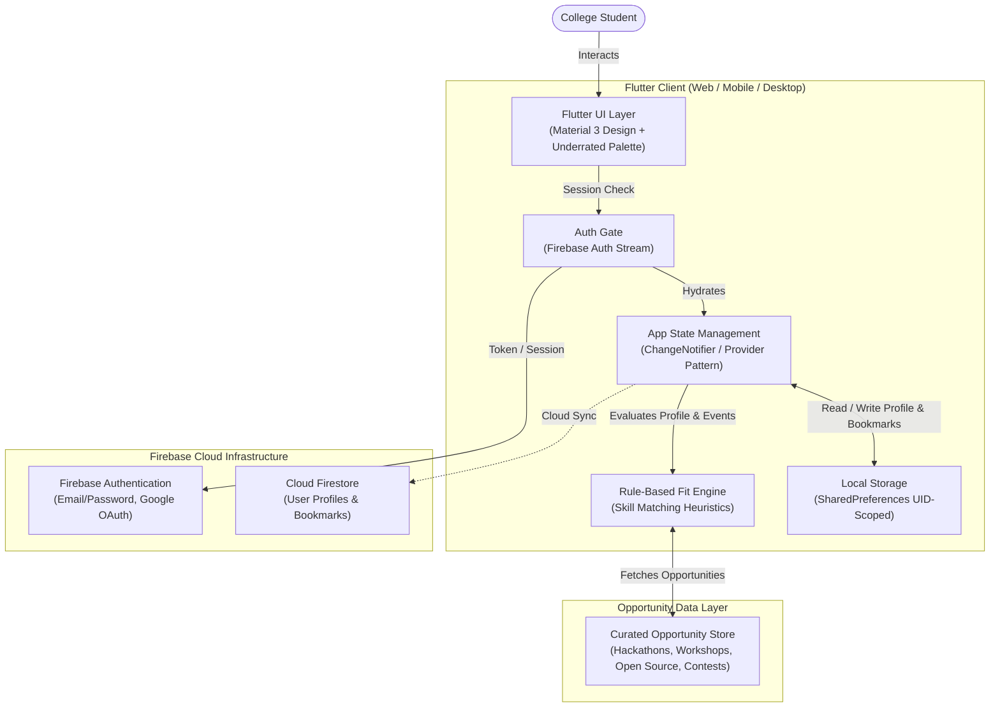
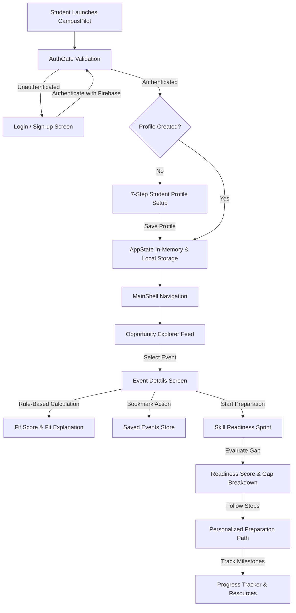

# CampusPilot Architecture Documentation 🏛️

This document details the system design, layered architecture, data pipeline, and security model of **CampusPilot**, an opportunity discovery and skill readiness MVP for college students.

---

## 1. High-Level Architecture Overview

CampusPilot uses a client-driven Flutter architecture connected to Firebase services for identity and cloud storage, with a local-first persistence layer for offline resilience and instantaneous state updates.

---

## 2. End-to-End Data Pipeline

The application execution follows a unidirectional data flow from authentication through opportunity discovery, gap analysis, and tailored preparation pathways:

---

## 3. Layered System Architecture

### 3.1 Presentation Layer (`lib/screens` & `lib/widgets`)
- **`AuthGate` (`lib/auth_gate.dart`)**: Stream-based authentication gate listening to `FirebaseAuth.instance.authStateChanges()`. Automatically routes users between unauthenticated landing screens and the authenticated workspace.
- **`MainShell` (`lib/screens/main_shell.dart`)**: Primary layout shell hosting the bottom navigation bar, floating action buttons, and standard scaffolding.
- **Screens**:
  - `LoginScreen` & `SignupScreen`: Email/Password and social sign-in UI.
  - `ProfileSetupScreen`: Progressive form wizard capturing student demographics, technical skills, interests, and profile links.
  - `OpportunityExplorerScreen`: Responsive discovery catalog with dynamic search, category chips, and live opportunity counters.
  - `EventDetailsScreen`: In-depth opportunity metadata card with fit score gauges and direct external registration links.
  - `SkillSprintChallengeScreen` & `SkillSprintResultScreen`: Interactive questionnaire sprint for skill readiness benchmarking.
  - `EventLearningPathScreen` & `BridgeMissionScreen`: Milestone-based preparation paths with learning resources and completion tracking.
- **Widgets**:
  - `ProfileDrawer`: Ergonomic slide-out drawer rendering student details, academic information, quick links, and drawer actions.
  - `OpportunityCard` & `EventCard`: Reusable high-contrast cards showcasing tags, mode badges, and match percentages.
  - `CampusCard`, `StatusBadge`, `TagChip`, `MetricRing`: Standardized design atoms.

### 3.2 State Management Layer (`lib/state/app_state.dart`)
- Centralized singleton `AppState` extending Flutter's `ChangeNotifier`.
- Responsibilities:
  - Tracking current `StudentProfile`.
  - Managing cached opportunities (`List<Opportunity>`).
  - Managing bookmarked opportunity IDs (`Set<String> savedEventIds`).
  - Calculating dynamic fit scores between student profile skills and opportunity prerequisites.
  - Providing observable state updates to the UI using `AnimatedBuilder` and reactive listeners.

### 3.3 Storage & Persistence Layer (`lib/storage/profile_storage.dart`)
- **Local Persistence**:
  - Backed by `SharedPreferences`.
  - Storage keys are namespaced by the authenticated user's Firebase UID (`profile_{uid}`, `saved_events_{uid}`).
  - Prevents data leakage between different users on shared devices.
- **Cloud Persistence (Firestore)**:
  - Prepared for Firebase Cloud Firestore synchronization.
  - Documents mapped to `users/{uid}/profile` and `users/{uid}/saved_events`.

### 3.4 Data Models (`lib/models`)
- **`StudentProfile` (`student_profile.dart`)**: Strongly-typed model representing student name, college, degree, department, graduation year, technical skills list, domain interests, preferred event types, GitHub URL, and LinkedIn URL. Includes serialization (`toMap`, `fromMap`).
- **`Opportunity` (`opportunity.dart`)**: Opportunity model encapsulating ID, title, organizer, category (Hackathon, Workshop, Open Source, Competition, Event), date, location, mode (Online/Offline/Hybrid), description, required skills, tags, external registration link, and calculated match score.
- **`PreparationStep` (`preparation_step.dart`)**: Structured step model containing milestone title, description, resources, difficulty level, and completion boolean.

---

## 4. Fit Scoring Engine (MVP Logic)

In the current MVP release, opportunity recommendations use a **transparent, rule-based skill and interest alignment formula** rather than opaque black-box algorithms:

$$\text{Fit Percentage} = \left( 0.6 \times \frac{|\text{Student Skills} \cap \text{Event Skills}|}{|\text{Event Skills}|} + 0.25 \times \text{Interest Alignment} + 0.15 \times \text{Type Alignment} \right) \times 100$$

Where:
1. **Skill Overlap (60% weight)**: Measures how many required skills the student already possesses.
2. **Interest Alignment (25% weight)**: Checks if the event category or domain aligns with the student's declared interests.
3. **Type Alignment (15% weight)**: Matches the opportunity type (e.g. Hackathon, Open Source) against the student's preferred engagement format.

This delivers deterministic, explainable recommendations that students can understand and trust.

---

## 5. Security & Privacy Architecture

1. **Authentication Gate**: Only verified Firebase sessions can access opportunity recommendations and student profile storage.
2. **Client-Only Secrets**: The client code contains only safe client credentials (`DefaultFirebaseOptions`). No service account private keys, admin credentials, or database secrets are included.
3. **Local Sandboxing**: Local cache storage is segmented by user UID so logging out fully clears the in-memory state.
4. **No Unsanctioned Scraping**: Opportunity details in the MVP use structured, curated data sets without scraping student personal credentials.
